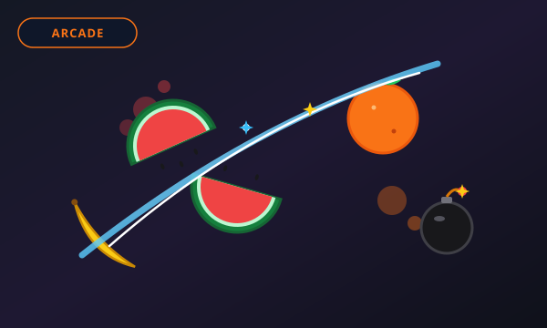

# 🕹 MINI GAME ARCADE

A responsive, high-performance web arcade portal featuring instant, zero-friction HTML5 browser games.



---

## 🌟 Overview

**Mini Game Arcade** is a curated web gaming platform built with clean, modern HTML5, CSS3, and ES6 JavaScript.

- **Zero Frameworks / Zero Bloat**: Extremely fast initial load, 60 FPS Canvas rendering, and procedural Web Audio API synthesizers.
- **Privacy First**: No tracking cookies, no accounts, no server databases. All progress and high scores are preserved locally via HTML5 `localStorage`.
- **Responsive & Accessible**: Seamlessly playable across smartphones, tablets, and desktop computers with keyboard, mouse, and multi-touch controls.
- **Zero Fake Content**: Only 100% verified, playable games are listed. No fake cards, no deceptive download buttons, and no intrusive ads.
- **Static Hosting Ready**: Fully deployable to Vercel, Netlify, or GitHub Pages.

---

## 🎮 Playable Games Catalog

### 1. 🍉 Fruit Slicer
- **Category**: Arcade & Reflex
- **Path**: [`games/fruit-slicer/index.html`](games/fruit-slicer/index.html)
- **Description**: Rapidly slice airborne watermelons, oranges, bananas, and strawberries with smooth blade trails. Build multi-cut combos (+3 points for slicing 3+ fruits in one swipe!) while avoiding dangerous explosive bombs.
- **Controls**:
  - **Desktop**: Click and drag your mouse rapidly across flying fruits.
  - **Mobile**: Swipe one or multiple fingers across tossed fruits.

### 2. 🚀 Cosmic Dodge
- **Category**: Action & Survival
- **Path**: [`games/cosmic-dodge/index.html`](games/cosmic-dodge/index.html)
- **Description**: Pilot your cartoon starship across 10 progressively challenging sectors. Dodge asteroid swarms and enemy drone lasers, trigger near-miss combos, and collect golden Energy Stars.
- **Controls**:
  - **Desktop**: `WASD` or `Arrow Keys` to move, `Spacebar` for Emergency Shield, `Esc` or `P` to pause.
  - **Mobile**: One-finger touch-and-drag flight with ergonomic touch offset; on-screen Shield button.

---

## 📂 Project Architecture

```
Mini Game Arcade/
├── index.html                   # Arcade Portal Homepage (Search, Categories, Grid)
├── about.html                   # About Us & Platform Philosophy
├── contact.html                 # Contact Form with Accessible Client-Side Validation
├── privacy.html                 # Plain-language Privacy Policy
├── terms.html                   # Terms of Service
├── vercel.json                  # Vercel Static Hosting & Security Headers
├── package.json                 # Project scripts (start, dev, test, build)
├── build.js                     # Production bundler for dist/
├── test.js                      # Automated platform verification suite
├── browser-test.js              # Headless Chrome E2E test runner
├── assets/
│   ├── favicon.svg              # Vector brand icon
│   └── thumbnails/              # Original vector thumbnails for game cards
├── css/
│   ├── arcade.css               # Portal styling, glassmorphism cards, responsive grid
│   └── style.css                # Cosmic Dodge game styling
├── js/
│   ├── games-data.js            # Central Registry of playable games & categories
│   ├── arcade.js                # Search & category filtering logic
│   └── [cosmic-dodge modules]   # Cosmic Dodge engine files
├── games/
│   ├── cosmic-dodge/            # Dedicated playable Cosmic Dodge page
│   └── fruit-slicer/            # Dedicated playable Fruit Slicer page
└── dist/                        # Production build output
```

---

## ➕ How to Add a New Game to the Arcade

Adding a new game to **Mini Game Arcade** requires just **3 simple steps** without touching any portal HTML:

### Step 1: Create the Game Directory
Create a subfolder in `games/<your-game-id>/` containing your game's `index.html` and assets:
```
games/my-new-game/
├── index.html
├── css/style.css
└── js/game.js
```
Include a top breadcrumb link back to the arcade home:
```html
<a href="../../index.html" class="back-link">← Mini Game Arcade</a>
```

### Step 2: Add an Original Vector Thumbnail
Add a 600x360 SVG thumbnail to `assets/thumbnails/<your-game-id>.svg`.

### Step 3: Register the Game in `js/games-data.js`
Open [`js/games-data.js`](js/games-data.js) and append your game configuration to the `GAMES` array:

```javascript
{
  id: "my-new-game",
  title: "My New Game",
  category: "Arcade & Reflex", // or "Action & Survival"
  badge: "New Release",
  description: "A short, engaging 1-2 sentence description of the game.",
  thumbnail: "assets/thumbnails/my-new-game.svg",
  path: "games/my-new-game/index.html",
  tags: ["Retro", "Puzzle", "Touch & Keyboard"],
  controls: {
    desktop: "Arrow keys to steer, Space to jump.",
    mobile: "Tap left/right to move, swipe up to jump."
  },
  features: [
    "Feature bullet 1",
    "Feature bullet 2"
  ]
}
```

The portal homepage will **automatically**:
- Render the new card in the responsive grid.
- Include the new game in live searches and category filter tabs.
- Update the live playable game counter.

---

## 💻 Local Development & Testing

```bash
# 1. Run the platform verification test suite
npm test

# 2. Run the production build
npm run build

# 3. Start local development server
npm start
# or
npm run dev
```

Visit **`http://localhost:3000`** in any web browser.

---

## ☁️ Static Deployment to Vercel

The site is pre-configured with `vercel.json` for static edge hosting:

### Via Vercel CLI
```bash
npm install -g vercel
vercel
```

### Via Git Integration
1. Push repository to GitHub/GitLab.
2. In [Vercel Dashboard](https://vercel.com), select **"Add New Project"**.
3. Choose your repository.
4. Set **Framework Preset** to `Other`.
5. Click **"Deploy"**. The portal and all games will be live globally in seconds!
